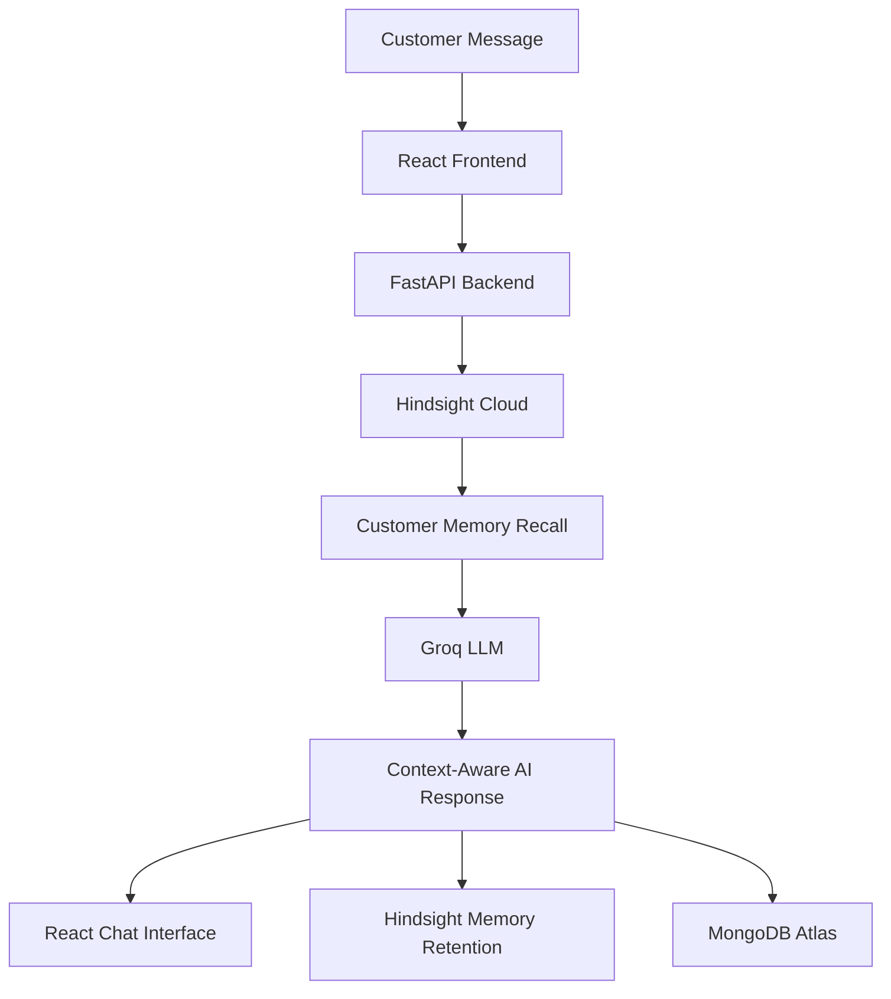

<<<<<<< HEAD
# MemorySupport AI 🧠⚡

> **Bengaluru 2.0 Hackathon Project**  
> Agentic Customer Support Copilot with Continuous Long-Term Memory, powered by **Hindsight Cloud**, **Groq Fast Inference**, and **MongoDB Atlas**.

---

## 🌟 Key Architecture

- **Agent Memory System**: [Hindsight Cloud](https://docs.hindsight.vectorize.io/) (`hindsight-client`) for multi-strategy retrieval (semantic, graph, temporal) across customer interactions and support history.
- **Fast Reasoning LLM**: [Groq](https://groq.com) (`groq-python`) running high-speed LLM inference (e.g. `openai/gpt-oss-120b` or `llama-3.1-8b-instant`) for instantaneous context-rich customer support suggestions.
- **Persistent Data Store**: [MongoDB Atlas](https://www.mongodb.com/atlas) (`motor` async) for structured customer profiles, tickets, and conversation sessions.
- **Backend API**: Python FastAPI (`uvicorn`, `pydantic-settings`, async SDK calls).
- **Frontend**: React 18, Vite, Tailwind CSS, Lucide icons.

---

## 📁 Repository Structure

```
MemorySupport-AI/
├── .gitignore
├── README.md
├── backend/
│   ├── .env.example
│   ├── requirements.txt
│   ├── app/
│   │   ├── __init__.py
│   │   ├── main.py
│   │   ├── core/
│   │   │   ├── __init__.py
│   │   │   └── config.py
│   │   └── clients/
│   │       ├── __init__.py
│   │       ├── hindsight_client.py
│   │       ├── groq_client.py
│   │       └── mongo_client.py
│   └── tests/
│       ├── __init__.py
│       ├── test_hindsight.py
│       ├── test_groq.py
│       └── test_mongo.py
└── frontend/
    ├── package.json
    ├── vite.config.js
    ├── tailwind.config.js
    ├── postcss.config.js
    ├── index.html
    └── src/
        ├── index.css
        ├── main.jsx
        └── App.jsx
```

---

## 🚀 Setup & Execution Guide

### 1. Backend Configuration

1. In the `backend` folder, create your `.env` file from `.env.example`:
   ```bash
   cp backend/.env.example backend/.env
   ```
2. Populate your secret credentials into `backend/.env`:
   - `HINDSIGHT_API_KEY`: Your Hindsight Cloud API key (`hs_...`)
   - `HINDSIGHT_BANK_ID`: `memorysupport-demo`
   - `GROQ_API_KEY`: Your Groq API key (`gsk_...`)
   - `MONGODB_URI`: Your MongoDB Atlas URI (`mongodb+srv://...`)

### 2. Install Backend Dependencies
=======
# 🧠 MemorySupport AI
### Customer Support That Remembers.

**An AI-powered customer support platform with persistent memory, personalized responses, and intelligent issue tracking.**

[](https://www.python.org/)
[](https://react.dev/)
[](https://fastapi.tiangolo.com/)
[](https://vectorize.io/)
[](https://groq.com/)
[](LICENSE)

---

## 🚀 Overview

Traditional customer support systems often forget previous conversations when a session ends. Customers must repeatedly explain their problems, preferences, and previous interactions.

**MemorySupport AI solves this problem using persistent AI memory.**

It remembers customer interactions, recalls previous issues, understands customer preferences, and generates context-aware support responses across multiple sessions.

Powered by **Hindsight Cloud and Groq**, MemorySupport AI aims to transform traditional customer support into a continuous, personalized experience.

## 🎯 Problem Statement

Traditional AI support bots have several limitations:

- They forget customer history between sessions.
- Customers repeatedly explain the same problems.
- Customer preferences are not consistently remembered.
- Previous failed solutions may be repeated.
- Support agents lack complete historical context.
- Recurring issues are difficult to identify.

## 💡 Our Solution

MemorySupport AI introduces a persistent-memory customer support assistant that:

- Remembers previous customer interactions.
- Recalls historical issues using Hindsight.
- Understands customer preferences.
- Generates personalized responses using Groq LLM.
- Maintains separate memory banks for individual customers.
- Tracks support conversations and ticket information.
- Supports future intelligent escalation and resolution workflows.

## ✨ Key Features

### 1. Persistent AI Memory
Uses Hindsight Cloud to retain and recall important customer information across conversations.

### 2. Personalized Customer Support
Remembers customer preferences, previous issues, and communication requirements.

### 3. Customer Memory Isolation
Each customer has a separate memory bank to prevent cross-customer information leakage.

### 4. AI-Powered Responses
Uses Groq inference with `openai/gpt-oss-120b` to generate memory-grounded support responses.

### 5. Memory Center
Provides a visual way to inspect recalled customer memories and understand the AI memory pipeline.

### 6. Customer Dashboard
Displays customer information, support activity, and interaction history.

### 7. Ticket Management
Provides a dashboard for viewing customer support issues and their statuses.

### 8. Idempotent Memory Retention
Uses deduplication to reduce duplicate memory writes during repeated requests.

## 🏗️ System Architecture



### Memory Pipeline

1. **Inbound Query:** Customer sends a support message.
2. **Memory Recall:** Hindsight retrieves relevant customer-specific memories.
3. **AI Reasoning:** Groq receives the customer message and recalled context.
4. **Response Generation:** The AI generates a personalized response.
5. **Memory Retention:** Important interaction information is retained for future conversations.
6. **Application Storage:** MongoDB is used for application records and interaction history.

## 🛠️ Technology Stack

| Technology | Purpose |
|---|---|
| React + Vite | Frontend |
| Tailwind CSS | UI styling |
| Python | Backend development |
| FastAPI | REST API |
| Hindsight Cloud | Persistent AI memory |
| Groq | LLM inference |
| MongoDB Atlas | Application data storage |
| Axios | API communication |
| Lucide Icons | UI icons |

## 🖥️ Dashboard Modules

- **Overview:** Customer support analytics and system architecture.
- **AI Support Assistant:** Interactive AI customer support chat.
- **Memory Center:** Customer memory inspection and recall.
- **Customers:** Customer information and selection.
- **Tickets:** Support issue tracking.

## 🧪 Demonstration Scenario

We demonstrate MemorySupport AI using synthetic customer profiles.

**Customer Alpha**
- Previously received a security camera with cracked glass housing.
- Prefers an expedited replacement instead of a refund.
- Prefers email updates rather than phone calls.

When Customer Alpha returns and asks about the previous issue, the AI recalls these preferences and responds with the relevant historical context.

**Customer Beta**

A separate customer with no prior memory. The system demonstrates that Customer Beta cannot access Customer Alpha's memories.

This demonstrates persistent memory and customer-level memory isolation.

## ⚙️ Installation and Setup

### Prerequisites

- Python 3.12+ (Python 3.14.6 used during development)
- Node.js 20+
- npm
- MongoDB Atlas account
- Hindsight Cloud API access
- Groq API key

### 1. Clone the repository

```bash
git clone https://github.com/KripaShankar7234/MemorySupport-AI.git
cd MemorySupport-AI
```

### 2. Backend setup
>>>>>>> 6c0dbe1cb8ad3cf0ab1d65d51bc2423fe9f7c8d0

```bash
cd backend
python -m venv venv
<<<<<<< HEAD
# Windows:
.\venv\Scripts\activate
# Linux/macOS:
source venv/bin/activate

pip install -r requirements.txt
```

### 3. Verification & Connection Tests

Run the dedicated connection test scripts:

```bash
# 1. Hindsight Cloud Connection & Memory Bank Test:
python tests/test_hindsight.py

# 2. Groq Fast LLM Inference Test:
python tests/test_groq.py

# 3. MongoDB Atlas Ping & CRUD Test:
python tests/test_mongo.py
```

### 4. Running the Backend Server
=======
```

Activate virtual environment on Windows:

```powershell
.\venv\Scripts\Activate.ps1
```

Install dependencies:

```bash
pip install -r requirements.txt
```

Create a local `.env` file using `.env.example` as a template.

Configure your own credentials:

```env
HINDSIGHT_BASE_URL=https://api.hindsight.vectorize.io
HINDSIGHT_API_KEY=your_hindsight_api_key
HINDSIGHT_BANK_ID=memorysupport-demo

GROQ_API_KEY=your_groq_api_key
GROQ_MODEL=openai/gpt-oss-120b

MONGODB_URI=your_mongodb_connection_string
DATABASE_NAME=memorysupport

FRONTEND_URL=http://localhost:5173
```

Start the backend using the entry point configured in the project. For the standard development setup:
>>>>>>> 6c0dbe1cb8ad3cf0ab1d65d51bc2423fe9f7c8d0

```bash
uvicorn app.main:app --reload --port 8000
```
<<<<<<< HEAD
Swagger UI documentation is available at: [http://localhost:8000/docs](http://localhost:8000/docs)

### 5. Running the Frontend Dashboard
=======

Backend health endpoint:

```text
http://localhost:8000/health
```

### 3. Frontend setup

Open another terminal:
>>>>>>> 6c0dbe1cb8ad3cf0ab1d65d51bc2423fe9f7c8d0

```bash
cd frontend
npm install
<<<<<<< HEAD
npm run dev
```
Open [http://localhost:5173](http://localhost:5173) in your browser.

---

## 🏆 Hackathon Live Judge Demonstration (2-Minute Script)

1. **Open the AI Support Assistant**:
   - Select **Customer Alpha (Rahul Sharma)**.
   - Click the 1-click test prompt: *"Can you confirm if I'm getting a refund or a replacement for my camera, and will you call me?"*
   - Watch the live **Hindsight Cloud** retrieval expand in the accordion:
     - Recalls damaged smart camera order.
     - Recalls preference for replacement rather than refund.
     - Recalls preference for email updates only (no phone calls).
   - Observe **Groq's grounded response**: confirms warehouse inspection is pending without inventing tracking or delivery dates.

2. **Demonstrate Customer Memory Isolation**:
   - Switch active customer to **Customer Beta (Priya Patel)**.
   - Ask the exact same question: *"What happened to my previous order?"*
   - Observe that **zero memories** are retrieved, and the AI greets Priya as a new customer without leaking Alpha's camera records!

3. **Inspect the Memory Center**:
   - Navigate to **Memory Center** in the sidebar.
   - Walk the judges through the **5-Step Continuous Memory Pipeline** and the **Multi-Tenant Memory Bank Isolation Comparator**.
=======
```

Create a local `.env` file:

```env
VITE_API_BASE_URL=http://localhost:8000
```

Start the frontend:

```bash
npm run dev
```

Open:

```text
http://localhost:5173
```

**Note:** Adjust the backend startup command if the actual application entry point differs.

## 🔐 Environment Variables and Security

Never commit API keys, passwords, database credentials, or `.env` files.

The repository uses `.gitignore` to exclude sensitive environment files.

Use `.env.example` for configuration templates only.

Never expose backend credentials in frontend code.

## 📂 Project Structure

```text
MemorySupport-AI/
│
├── backend/
│   ├── app/
│   │   ├── api/
│   │   ├── services/
│   │   ├── config.py
│   │   └── main.py
│   ├── tests/
│   ├── requirements.txt
│   └── .env.example
│
├── frontend/
│   ├── src/
│   │   ├── components/
│   │   ├── pages/
│   │   ├── services/
│   │   └── App.jsx
│   ├── package.json
│   └── .env.example
│
├── .gitignore
├── LICENSE
└── README.md
```

*The structure above describes the intended organization; actual filenames may vary with implementation.*

## 🧪 Testing

Backend integration tests:

```bash
python tests/test_groq.py
python tests/test_chat_api.py
```

These tests cover:

- Groq inference.
- Hindsight memory retention and recall.
- FastAPI health and chat endpoints.
- Customer-specific memory isolation.
- Idempotent memory retention.

MongoDB persistence should be separately verified with an actual database write and read.

## 🌍 Real-World Impact

MemorySupport AI can benefit:

- E-commerce customer support.
- Banking and financial customer service.
- SaaS support platforms.
- Telecom customer service.
- Technical support teams.
- Enterprise helpdesk operations.

By remembering customer history, businesses can reduce repetitive conversations and provide more personalized support.

## 🔮 Future Enhancements

- Automated issue escalation.
- Advanced memory evolution and relationship detection.
- Real-time support analytics.
- Email notification integration.
- Voice-based AI support.
- Agent handoff and human-in-the-loop workflows.
- Advanced customer sentiment analysis.
- Production deployment and monitoring.

## 👥 Team

**Project:** MemorySupport AI  
**Hackathon:** Bengaluru 2.0  
**Institution:** East West Institute of Technology, Bengaluru

Developed collaboratively by our hackathon team.

## 📌 Project Status

**Hackathon prototype — Active Development**

Core Hindsight and Groq integrations and the FastAPI chat pipeline have been tested. Frontend integration and dashboard development are in progress. MongoDB persistence and production deployment require further verification.

## 📜 License

This project is licensed under the MIT License. See [LICENSE](LICENSE).

---

### ⭐ Support the Project

If you find this project interesting, consider giving the repository a star!

**MemorySupport AI — Because great customer support should never forget.**
>>>>>>> 6c0dbe1cb8ad3cf0ab1d65d51bc2423fe9f7c8d0
